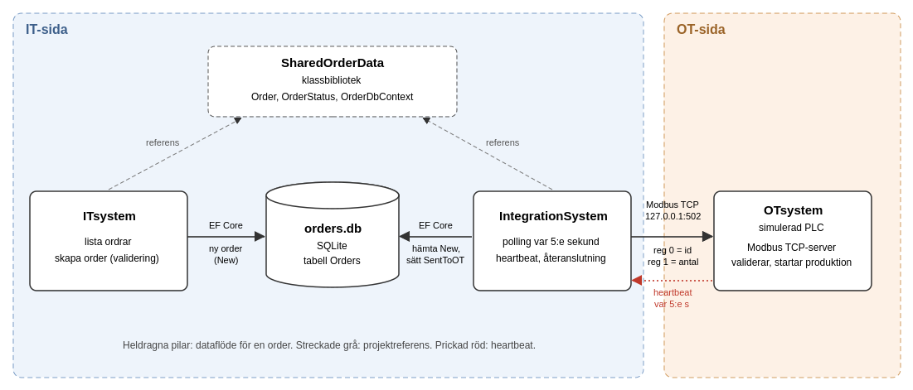
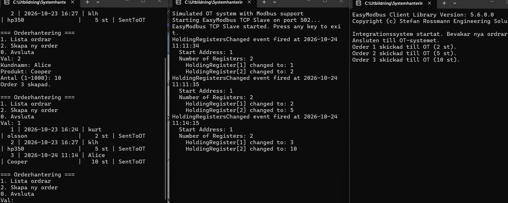
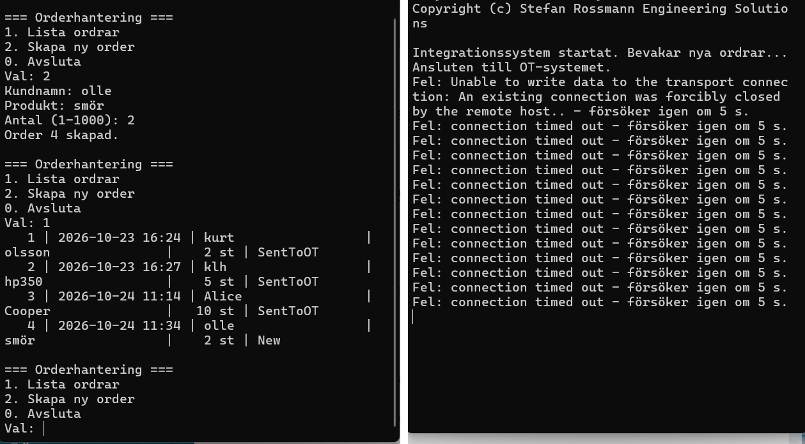
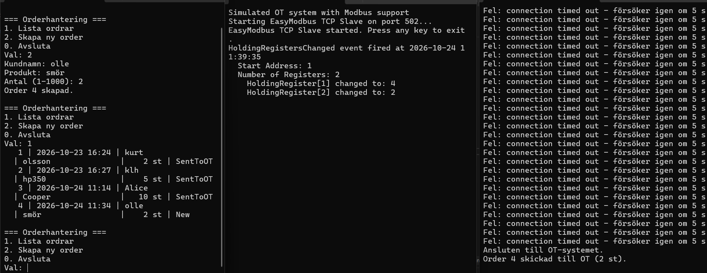
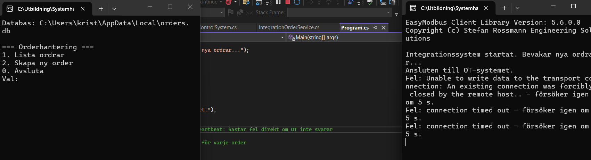
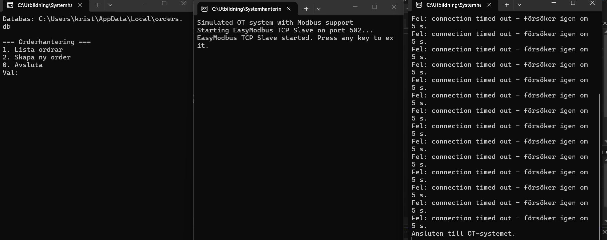
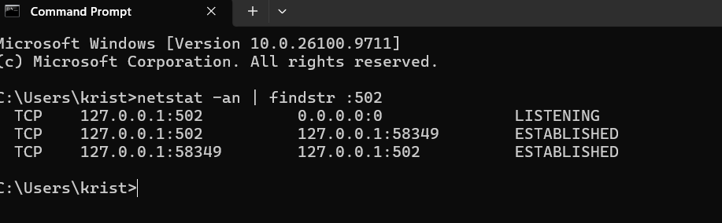
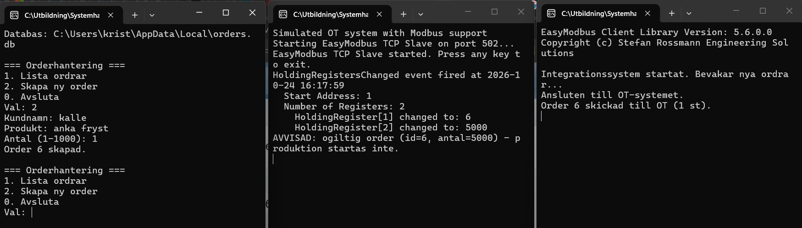

# Redovisning inlämning: Automatisering och säkerhetsintegration av ett produktionssystem

## 1. Inledning

Ett tillverkningsföretag upplever frekventa avbrott och ineffektivitet i sin produktionslinje. Orsaken är manuell hantering och bristande integration mellan IT-systemets orderhantering och OT-systemets produktion. Det finns en oro för säkerhetsbrister i de manuella processerna och för bristande insyn i produktionsdata.

Utan integration måste någon läsa ordrarna i IT-systemet och mata in dem i produktionen för hand. Det tar tid, ökar kostnaderna och medför risk för fel och avbrott. Genom att automatisera överföringen tas de manuella stegen bort, hanteringen går snabbare och felrisken minskar.

Denna rapport beskriver design, implementering och test av en lösning som automatiserar process a: automatisk orderhantering från IT-systemet som initierar en produktionskörning i OT-systemet. 

## 2. Design och arkitektur

### 2.1 Arkitektur

Lösningen består av tre program och ett gemensamt klassbibliotek. ITsystem och IntegrationSystem refererar båda till SharedOrderData, som innehåller orderklassen och databaskopplingen. Därför använder de samma databas, orders.db.

Orderflöde:

1.  En order skapas i ITsystem. Den sparas i databasen med status New.

2.  IntegrationSystem kontrollerar databasen var femte sekund och hämtar ordrar med status New.

3.  Varje order skickas till OTsystem via Modbus TCP: order-id i register 0 och antal i register 1.

4.  När sändningen lyckats sätter IntegrationSystem orderns status till SentToOT.

5.  OTsystem validerar ordern och startar produktionen.

IntegrationSystem läser dessutom ett register från OTsystem varje varv (heartbeat) för att upptäcka avbrott. IT- och OT-sidan kommunicerar enbart via integrationsprogrammet.



*Bild 1: Lösningens arkitektur. ITsystem och IntegrationSystem delar databasen orders.db via klassbiblioteket SharedOrderData. IntegrationSystem skickar ordrar till OTsystem via Modbus TCP och kontrollerar var femte sekund med heartbeat att OT svarar. Heldragna pilar visar hur en order flödar, streckade grå pilar visar projektreferenser och den prickade röda pilen visar heartbeat.*

OT-systemet som används är från Slides och Youtube-filmen i undervisningsmaterielet.

### 2.2 Teknikval

**C# och .NET 8.** Uppgiften kräver C#. Alla tre programmen är konsolprogram i samma lösning och använder .NET 8. Samma språk och version i alla delar gör att de kan dela kod.

**Gemensamt klassbibliotek (SharedOrderData).** Både ITsystem och IntegrationSystem behöver samma orderklass och databaskoppling. Genom att lägga dem i ett klassbibliotek finns koden på ett ställe, och båda programmen använder samma datamodell.

**SQLite och Entity Framework Core.** SQLite är en databas i en enda fil och kräver ingen databasserver. Det gör lösningen enkel att installera och köra. Båda programmen pekar på samma fil, så de delar data. EF Core används eftersom man då kan arbeta med C#-klasser i stället för SQL. Vid installation av EF Core behövdes version 8 för att matcha .NET 8. Ett tredjepartspaket med liknande namn (utgivare chenmingming) valdes bort, eftersom okända paket med nästan samma namn är en säkerhetsrisk (supply chain-attack). I stället valdes Microsofts verifierade paket.

**EasyModbus.** EasyModbus användes eftersom det finns i kursmaterialet och innehåller både en Modbus-klient (används av IntegrationSystem) och en Modbus-server (används av OT-systemet)**.** En nackdel är att Modbus TCP saknar autentisering och kryptering. Det behandlas i säkerhetsanalysen.

**Polling var femte sekund.** Integrationen kontrollerar databasen var femte sekund efter nya ordrar. Om OT-systemet varit nere ligger ordrarna kvar med status New och skickas automatiskt när förbindelsen är tillbaka. Fem sekunders fördröjning bedöms som acceptabelt för att starta en produktionsorder.

## 3. Implementering

Koden är genomgående kommenterad i större utsträckning än vad som normalt görs i produktionskod. Det är ett medvetet val eftersom detta är ett skolarbete där koden förklaras mer detaljerat. I ett verkligt projekt hade kommentarerna varit betydligt mer sparsamma.

### 3.1 SharedOrderData

I klassbiblioteket, SharedOrderData: klassen Order.cs beskriver **vad en order är** och vilka uppgifter varje order har. Den gör ingenting själv (den saknar metoder). Den är en mall för data. 

EF Core behöver klassen Order för att bygga databasen:

- Klassen blir en tabell, Orders.

- Varje egenskap blir en kolumn: Id, CustomerName, Product, Quantity, CreatedAt, Status.

- Varje Order-objekt som skapas i koden blir en rad i tabellen

Orderns status är en enum (OrderStatus) med värdena New och SentToOT. Det gör att endast giltiga statusvärden kan förekomma, och att ett stavfel upptäcks av kompilatorn i stället för att leda till att integrationen inte hittar ordern.

### 3.2 DbContext

DbContext håller reda på tre saker:

1.  Vilken databas: SQLite-filen orders.db (OnConfiguring).

2.  Vilka tabeller: Orders, som består av Order-objekt (DbSet\<Order\>).

3.  Vad som har ändrats: när en order ändras eller läggs till kommer den ihåg det, och när SaveChanges() anropas skickas alla ändringar till databasen på en gång.

### 3.3 ITsystem

Menyval 1 listar alla ordrar och menyval 2 skapar en ny order. Program sköter menyn och kontrollerar inmatningen, medan OrderService sköter all kontakt med databasen.

**1. CreateOrder i Program** styr flödet. Den frågar efter kundnamn, produkt och antal och skickar sedan värdena vidare till OrderService.

**2. ReadRequired** frågar efter text och släpper inte igenom tomma svar eller svar över 100 tecken. Den frågar igen tills svaret är giltigt.

**3. ReadInt** frågar efter ett tal och släpper inte igenom sådant som inte är ett heltal mellan 1 och 1000. int.TryParse kontrollerar att det är ett tal utan att programmet kraschar om det inte är det.

**4. CreateOrder i OrderService** tar emot de kontrollerade värdena och skapar ett Order-objekt. Med Add + SaveChanges sparar den objektet i databasen. Databasen ger ordern ett id, som skickas tillbaka.

**5**. Tillbaka i **Program** skrivs “Order 1 skapad.” ut.

### 3.4 IntegrationSystem

Integrationens uppgift är att flytta ordrar från IT till OT automatiskt. Därför behöver den göra två saker:

1.  Hämta nya ordrar: integrationen måste ta reda på vilka ordrar som väntar på att skickas till produktionen (=status New).

2.  Markera ordrar som skickade: integrationen måste komma ihåg vad den redan har gjort. Loopen körs var femte sekund. Utan markeringen skulle samma ordrar skickas om och om igen, och produktionen skulle starta samma order varje gång, i det oändliga.

En bonus är att status blir synlig i ITsystem. När ordrar listas syns direkt vilka som har gått till produktionen och vilka som fortfarande väntar.

Integrationsprogrammet är en automatisk budbärare mellan IT och OT. Var femte sekund gör det samma sak:

1.  Kontrollerar anslutningen till OT. Om programmet inte är anslutet försöker det ansluta.

2.  Frågar databasen om det finns nya ordrar, alltså ordrar med status New.

3.  För varje ny order:

    - skickar order-id och antal till OT-systemet via Modbus

    - markerar ordern som SentToOT i databasen, så att den inte skickas igen

    - skriver ut att ordern är skickad

4.  Om något går fel, till exempel om OT-systemet är avstängt: skriver ut felet, kopplar ner och försöker igen nästa varv i stället för att krascha.

5.  Väntar 5 sekunder och börjar om.

### 3.5 Heartbeat

Notering: Integrationen märker inte att OT är nere förrän den har något att skicka. I en riktig produktionsmiljö vill man veta det direkt.

Åtgärd: lägga till “heartbeat” ( en signal som skickas eller kontrolleras regelbundet för att visa att ett system lever. Uteblir signalen räknar man med att något är fel.) Implementeras i Program.cs i IntegrationSystem.

- **ReadHoldingRegisters(0, 1)** läser ett register från OT. Vilket värde som kommer tillbaka spelar ingen roll. Syftet är bara att kontrollera att OT svarar.

- Det sker varje varv, alltså var femte sekund, oavsett om det finns ordrar eller inte.

- Om OT är nere kastar läsningen ett undantag. Undantaget fångas av den befintliga felhanteringen, som kopplar ner och försöker ansluta igen nästa varv

- Heartbeaten ligger före orderhanteringen. Därför försöker integrationen aldrig skicka ordrar till ett OT-system som den redan vet inte svarar.

I en riktig produktionsmiljö är skillnaden viktig. Ett avbrott mellan IT och OT upptäcks inom sekunder och kan larmas, i stället för att upptäckas först när en order fastnar.

### 3.6 Centrala kodavsnitt

Integrationsloopen (IntegrationSystem/Program.cs): Loopen är kärnan i automatiseringen. Var femte sekund kontrolleras anslutningen till OT, nya ordrar hämtas och skickas, och varje order markeras som skickad först efter lyckad sändning.

Kod (förkortat):

```csharp
while (true)
{
    try
    {
        if (!modbusClient.Connected)
            modbusClient.Connect();

        modbusClient.ReadHoldingRegisters(0, 1);   // heartbeat

        var newOrders = orderService.GetNewOrders();
        foreach (var order in newOrders)
        {
            modbusClient.WriteMultipleRegisters(0, new[] { order.Id, order.Quantity });
            orderService.MarkAsSent(order.Id);       // markeras först efter lyckad sändning
        }
    }
    catch (Exception ex)
    {
        Console.WriteLine($"Fel: {ex.Message} - försöker igen om 5 s.");
        try { modbusClient.Disconnect(); } catch { }
    }
    Thread.Sleep(5000);
}
```

Säkerhetsåtgärderna (localhost-bindning och validering i OT-systemet) beskrivs i avsnitt 4.

## 4. Säkerhetsanalys och åtgärder

### 4.1 Identifierade risker

**Obehörig åtkomst**

- OT-systemet lyssnade som standard på alla nätverkskort på port 502, så vem som helst på nätverket kunde skriva till registren och starta produktion.

- Modbus TCP saknar autentisering och kryptering.

- ITsystem har ingen inloggning.

**Datamanipulation**

- Felaktig inmatning i ITsystem (tomma fält, orimliga antal).

- OT-systemet validerade inte inkommande värden.

- Ordrar kan manipuleras under överföringen, eftersom Modbus saknar integritetskontroll.

**Systemfel**

- OT-systemet eller nätverket kan gå ner, med risk för att ordrar går förlorade eller skickas två gånger.

**Tredjepartsberoenden**

- NuGet-paket kan vara förfalskade eller innehålla sårbarheter (supply chain-attacker).

### 4.2 Implementerade åtgärder

**OT-systemet lyssnar endast på localhost**  
Åtgärd: Koden modifierades i IndustrialControlSystem.cs med modbusServer.LocalIPAddress = IPAddress.Loopback;, vilket gör att OT-systemet endast lyssnar på 127.0.0.1 och inte är nåbart från andra datorer på nätverket. Porten går inte att nå från nätverket, vilket tar bort den största attackytan.

**Validering av inmatning i ITsystem**  
Åtgärd: Alla fält kontrolleras innan en order sparas. Kundnamn och produkt får inte vara tomma eller längre än 100 tecken, och antalet måste vara ett heltal mellan 1 och 1000. Felaktig inmatning avvisas och användaren får försöka igen, så att ogiltiga ordrar aldrig når databasen. Verifierat genom att mata in tomt namn, “abc”, 0 och 5000. Alla avvisades utan att programmet kraschade.

**Skydd mot SQL-injektion**  
Åtgärd: All databaskommunikation sker via EF Core, som använder parametriserade frågor. Inmatad text behandlas alltid som data och aldrig som SQL-kod, vilket skyddar mot SQL-injektion.

**Validera inkommande värden i OT-systemet**

Åtgärd: Koden i OT-systemet (IndustrialControlSystem.cs, eventet HoldingRegistersChanged) har kompletterats med kontroller innan produktion startas:

- En giltig order består alltid av två register, id och antal. Skrivs bara ett register är ordern inte komplett.

- Databasens id börjar på 1, så 0 eller negativa värden är ogiltiga.

- Antalet kontrolleras mot samma intervall som i IT-systemet (1–1000).

Om någon kontroll misslyckas avvisas ordern, en varning skrivs ut och produktionen startas inte. Att samma kontroll görs både i IT- och OT-systemet är ett exempel på *defense in depth*: flera skyddslager, så att ett fel i ett lager fångas av nästa.

**Begränsar konsekvenserna av:**

- Ett annat program på samma dator. Localhost-skyddet stänger bara ute andra datorer, och eftersom Modbus saknar autentisering kan varje program på datorn ansluta till port 502 och skriva.

- Manipulation på vägen (man-in-the-middle), eftersom Modbus saknar kontroll av att data inte ändrats under överföringen.

- En bugg i integrationen, till exempel efter en framtida kodändring.

**Begränsning:** valideringen stoppar endast värden utanför de giltiga gränserna. Ett manipulerat men giltigt värde, till exempel ett ändrat antal inom 1–1000, upptäcks inte. Skydd mot det kräver autentisering och integritetskontroll av kommunikationen, till exempel Modbus/TCP Security med TLS eller en krypterad tunnel, vilket Modbus TCP inte har i grundutförandet.

**Systemfel**

Integrationen kraschar inte om OT går ner. Den upptäcker avbrottet med heartbeat, ansluter igen automatiskt, och ingen order går förlorad. Verifierat genom att stänga och starta om OT-systemet.

### 4.3 Tredjepartsberoenden

Förtroende för tredjepartskod är alltid en riskbedömning och ingen garanti. Positivt för tredjepartskoden kan tex vara: 

- **Öppen källkod:** vem som helst kan granska koden på GitHub.

- **Lång historik:** ett paket som har funnits i flera år utan kända incidenter.

- **Många nedladdningar:** fler användare gör ofta att problem upptäcks snabbare.

- **Samma utgivare** på NuGet och GitHub.

**Vad man kan göra för att minska risker:**

- **Låsa versionen** så att en ny och eventuellt skadlig version inte installeras automatiskt.

- **Söka efter kända sårbarheter:** köra dotnet list package --vulnerable i terminalen.

- **Begränsa skadan om något går fel:** i ett riktigt OT-nät körs integrationen i ett segmenterat nät med minsta möjliga behörighet.

I lösningen kontrollerades utgivaren för båda paketen: EF Core-paketet från Microsoft (verifierat) valdes framför ett tredjepartspaket med liknande namn, och EasyModbusTCP kontrollerades mot utgivaren Stefan Rossmann.

### 4.4 Kvarstående risker

- Modbus saknar autentisering och kryptering, så giltiga men manipulerade värden kan inte upptäckas.

- IT-systemet saknar inloggning.

- Databasfilen är inte skyddad.

- OT kan inte meddela integrationen när en order avvisas.

## 5. Testning och resultat

Lösningen har testats med manuella systemintegrationstester, där alla tre programmen körs samtidigt och hela kedjan från order i IT-systemet till mottagning i OT-systemet kontrolleras. Både positiva tester (att det fungerar som det ska) och negativa tester (att fel hanteras utan att programmet kraschar) har genomförts. Resultaten verifierades genom programmens utskrifter, orderlistan i IT-systemet och kommandot netstat. Skärmdumpar redovisas som bevis under respektive test.

### 5.1 Hela kedjan IT → OT

Test 1:

| **Test**           | **Gör så här**                     | **Förväntat resultat**                                                   |
|--------------------|------------------------------------|--------------------------------------------------------------------------|
| Anslutning         | Titta i IntegrationSystem-fönstret | “Ansluten till OT-systemet.”                                             |
| Ny order           | Skapa en order i ITsystem          | Inom 5 s: “Order X skickad” i integrationen, och register-ändringar i OT |
| Status             | Lista ordrar i ITsystem            | Den nya ordern har status SentToOT                                       |
| Gamla ordrar       | Titta direkt efter start           | Tidigare skapade ordrar (status New) skickas automatiskt                 |
| Inget skickas igen | Vänta några varv                   | Samma order skickas inte en gång till                                    |



*Bild 2: Hela kedjan. Order 1–3 skickas från IT till OT och får status SentToOT.*

- **Gamla ordrar skickades automatiskt vid start:** order 1 och 2, skapade med status New, gick iväg direkt när integrationen anslöt.

- **Ny order gick igenom:** order 3 (Alice, 10 st) skapades i ITsystem och kom fram till OT inom några sekunder.

- **Rätt data kom fram: i** OT-fönstret står register 1 = order-id och register 2 = antal, och det stämmer med integrationens utskrift. EasyModbus förskjuter adresserna ett steg internt: integrationen skriver till adress 0, men OT visar Start Address: 1.

- **Status uppdaterades:** listan i ITsystem visar SentToOT för ordrarna.

- **Inget skickades igen:** varje order förekommer bara en gång i OT.

### 5.2 OT-systemet går ner

Test 2

| **Test**           | **Gör så här**                                       | **Förväntat resultat**                                     |
|--------------------|------------------------------------------------------|------------------------------------------------------------|
| OT faller bort     | Stäng OT-fönstret                                    | Integrationen skriver fel var 5:e sekund men kraschar inte |
| OT kommer tillbaka | Högerklicka på OTsystem → Debug → Start New Instance | Integrationen ansluter igen av sig själv                   |



*Bild 3: OT-systemet är nere. Order 4 ligger kvar med status New och integrationen försöker igen var femte sekund.*

En ny order (order 4) skapades i ITsystem medan OT var nere. Integrationen försökte skicka den, misslyckades och skrev ut ett fel var femte sekund. Ordern behöll status New, eftersom den aldrig kom fram.

Startar OTsystem igen 

- **Order 4 skapades medan OT var nere.** Den fick status New och låg kvar i databasen. Den gick alltså inte förlorad.

- **Integrationen kraschade inte.** Den skrev “connection timed out” var femte sekund och försökte igen.

- **När OT startades igen** anslöt integrationen av sig själv (“Ansluten till OT-systemet”).

- **Order 4 skickades direkt** och kom fram till OT: register 1 = 4 (order-id) och register 2 = 2 (antal).



*Bild 4: OT-systemet har startats igen. Integrationen återansluter och order 4 skickas.*

Testet visar både felhanteringen (inget kraschar) och tillförlitligheten (ingen order går förlorad vid avbrott).

### 5.3 Heartbeat

OT stängdes utan att någon ny order skapades. Inom 5 sekunder kom felet “An existing connection was forcibly closed by the remote host”. Det var heartbeat-läsningen som misslyckades: integrationen upptäckte avbrottet direkt, inte först när en order kom**.**



*Bild 5: Heartbeat upptäcker att OT-systemet stängts, utan att någon ny order skapats.*

De två felmeddelandena visar två olika saker:

- **“forcibly closed by the remote host”**: heartbeaten upptäcker att den befintliga anslutningen har brutits.

- **“connection timed out”**: försöken att återansluta misslyckas, eftersom OT fortfarande är nere.



*Bild 6: När OT startades igen anslöt integrationen av sig själv.*

### 5.4 OT lyssnar endast på localhost

**127.0.0.1:502 ... LISTENING**: OT-systemet väntar på anslutningar, men bara på localhost. Före ändringen hade det stått 0.0.0.0:502, vilket betyder alla nätverkskort.



*Bild 7: netstat visar att OT-systemet endast lyssnar på 127.0.0.1:502.*

### 5.5 Validering i OT (fault injection)

**Negativt test (fault injection)**  
Integrationen ändrades tillfälligt att skicka ett ogiltigt antal: `modbusClient.WriteMultipleRegisters(0, new[] { order.Id, 5000 });`  
**Förväntat resultat:** OT avvisar ordern och startar inte produktion.  
**Resultat:** OK. OT skrev “AVVISAD: ogiltig order ...” (Bild 8). Koden återställdes efter testet.



*Bild 8: OT avvisar en order med antal 5000 (fault injection).*

Integrationens utskrift visar ”1 st” eftersom endast det skickade värdet ändrades i testet, inte utskriften.

## 6. Slutsats och reflektion

### 6.1 Sammanfattning

Lösningen automatiserar överföringen av ordrar från IT-systemet till OT-systemet. Ingen behöver längre läsa ordrar och mata in dem i produktionen för hand. Det sparar tid och minskar risken för fel och avbrott, vilket ger lägre kostnader. Orderns status visas i IT-systemet - det ger insyn i vilka ordrar som gått till produktion. Säkerheten har förbättrats genom att OT-systemet bara kan nås lokalt, att inmatning valideras i både IT och OT, och att integrationen tål avbrott utan att ordrar går förlorade.

### 6.2 Utmaningar och lärdomar

- Vid installation av EF Core visade NuGet bara den senaste versionen. Jag fick välja version 8 för att matcha .NET 8. Jag hittade också ett tredjepartspaket med liknande namn, vilket visade hur lätt man kan installera fel paket.

- Under testningen upptäckte jag att integrationen inte märkte att OT var nere förrän den hade en order att skicka. Det löstes med en heartbeat. Det visar att tester inte bara bekräftar att något fungerar, utan också hittar brister.

- Jag har lärt mig att Modbus TCP saknar inbyggd säkerhet och att man därför måste skydda kommunikationen på andra sätt, t.ex. med nätverksbegränsning och validering i flera lager (defense in depth).

### 6.3 Förbättringar

- OT-systemet bör kunna meddela integrationen om en order avvisats, så att IT-systemet visar rätt status.

- Inloggning i IT-systemet och autentisering och kryptering av kommunikationen, t.ex. Modbus/TCP Security med TLS.

- Avbrott och avvisade ordrar skulle kunna skapa larmärenden i IT-systemet i stället för att bara skrivas ut i konsolen.

### 6.4 Förebyggande av sårbarheter och incidenter

Lösningen förebygger problem genom att felaktiga data stoppas tidigt, både i IT och i OT, och genom att OT-systemet inte är nåbart från nätverket. Om en incident ändå inträffar, t.ex. att OT går ner, upptäcks den inom fem sekunder tack vare heartbeat. Ordrarna ligger kvar och skickas automatiskt när systemet är tillbaka, så produktionen kan återupptas utan manuellt arbete.
